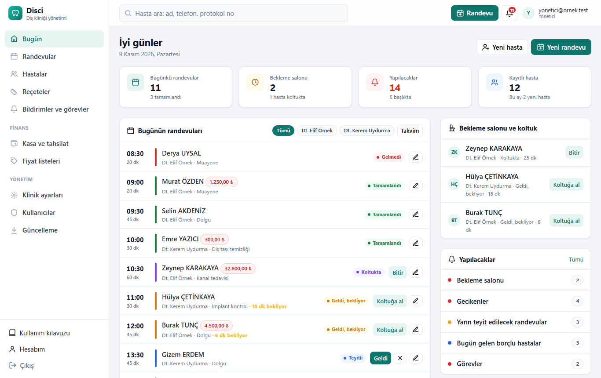
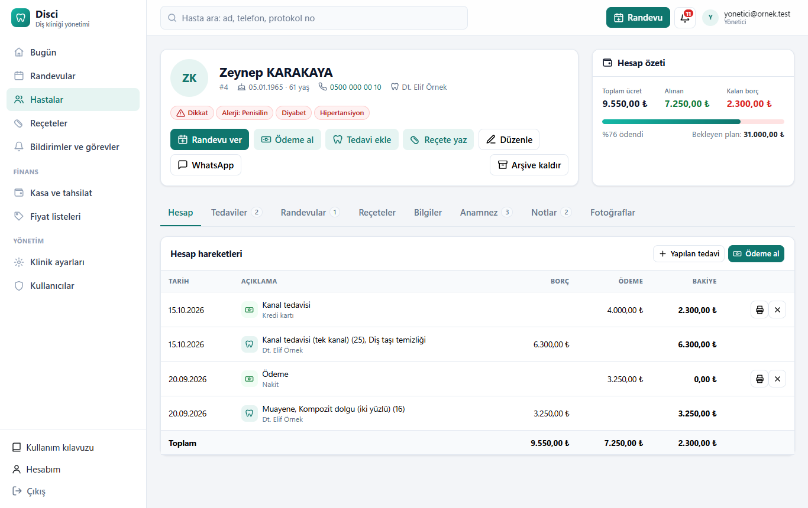
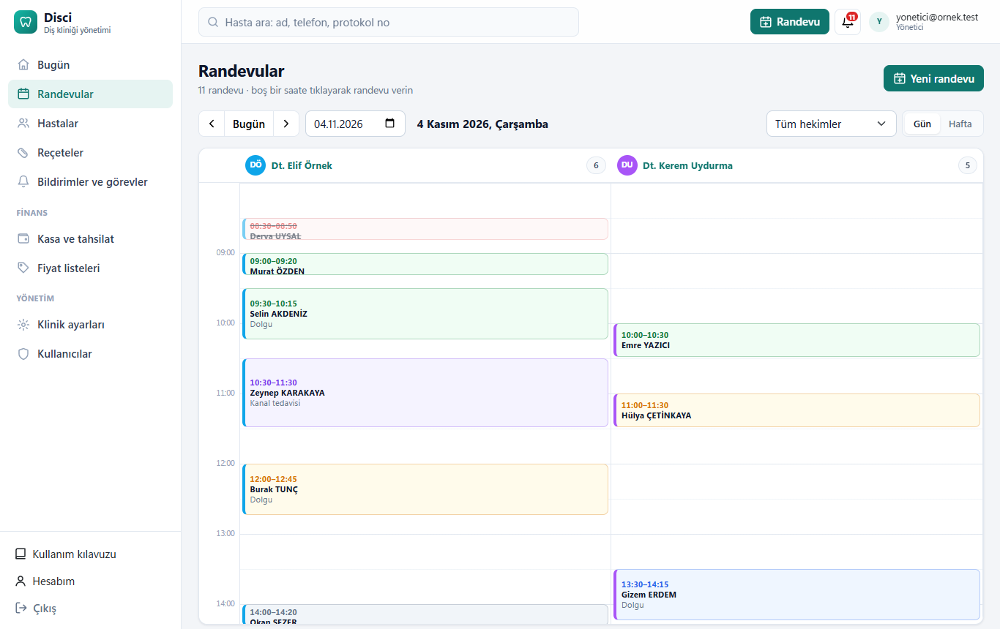
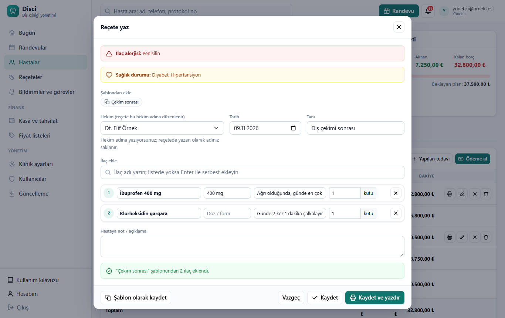
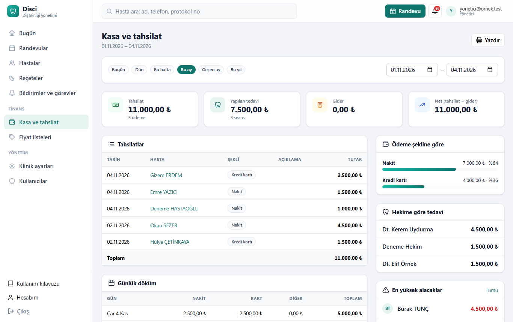

<p align="center"></p>

<h1 align="center">Disci</h1>

<p align="center"><b>Diş klinikleri için ücretsiz ve açık kaynak hasta takip programı</b><br>
Randevu · Hasta kartı · Diş şeması · Tedavi ve ödeme · Reçete · Kasa · Çoklu hekim ve kullanıcı</p>

<p align="center">
<a href="https://github.com/mehmet-cizmeci/Disci/releases">İndir</a> ·
<a href="docs/Kurulum-Rehberi.md">Kurulum rehberi</a> ·
<a href="docs/Kullanim-Kilavuzu.md">Kullanım kılavuzu</a> ·
<a href="docs/Kullanim-Kilavuzu.pdf">Kılavuz (PDF)</a>
</p>

---

Disci, kliniğinizdeki bir Windows bilgisayara kurulur ve orada arka planda sürekli çalışır. Siz onu **tarayıcıdan**
kullanırsınız: aynı bilgisayardan, klinik ağındaki diğer bilgisayarlardan, tablet ve telefonlardan. Ücret, lisans,
abonelik ya da internet bağlantısı gerekmez; **hasta bilgileri kliniğinizin bilgisayarından dışarı çıkmaz.**



## Özellikler

**Resepsiyon ve randevu**
- **Bugün** panosu: günün randevuları, tek tıkla *Teyit → Geldi → Koltukta → Bitti*, bekleme salonu ve bekleme süreleri, borçlu hasta uyarısı
- **Randevu takvimi:** hekim sütunlu gün görünümü ve hafta görünümü, boş saate tıklayarak randevu, hekim/hasta çakışma kontrolü, kayıtsız (misafir) hasta
- **WhatsApp ile hatırlatma** mesajı tek tıkla hazır
- **Bildirimler:** bekleyen ve geciken hastalar, yarın teyit edilecekler, bugün gelen borçlular, görevler, doğum günleri, 6 ay kontrol hatırlatması
- Bütün ekranlar anında güncellenir: resepsiyonda "Geldi" yapılan hasta hekimin ekranında hemen görünür

**Hasta kartı**
- Türkçe harf ve büyük/küçük harf duyarsız hızlı arama (ad, telefon, protokol no)
- Kırmızı **sağlık uyarıları** (alerji, diyabet, kalp hastalığı…) ve ayrıntılı **anamnez**
- **Hesap özeti** ve yürüyen bakiyeli borç-ödeme ekstresi
- Gerçek ağız kavsi şeklinde, dişlerin boyutuna oranlı **FDI diş şeması** (kalıcı ve süt dişleri)
- **Tedavi planı → yapıldı** akışı, bulgular (eksik diş, çürük…), dişe özel notlar, fotoğraflar
- Benzer kayıt uyarısı (aynı TC, ad-soyad veya telefon), arşiv

**Ödeme, reçete ve finans**
- Ödeme alma (nakit, kart, havale, çek/senet), **yazdırılabilir makbuz** (tutar yazıyla), ödeme iptali (silinmez, iz kalır)
- **Reçete:** ilaç listesi, şablonlar, hastanın alerjisiyle eşleşen ilaçta uyarı, hekim adına yazma, A5 çıktı
- **Kasa raporu:** tarih aralığına göre tahsilat, tedavi, gider; ödeme şekline ve hekime göre dağılım, en yüksek alacaklar
- **Fiyat listeleri:** birden çok tarife, KDV, toplu yüzde güncelleme, hastaya özel tarife ve indirim

**Yönetim ve güvenlik**
- **Çoklu hekim**, roller: Yönetici, Hekim, Asistan (asistan randevu ve kayıt girer, finans ve ayarları göremez)
- Hatalı parolada hesap kilidi, passkey (parmak izi/yüz/PIN) ve iki adımlı doğrulama
- Klinik ağında **HTTPS** (kliniğe özel sertifika), güvenlik duvarı yalnızca özel ağa açılır
- **Her gün otomatik yedek** (varsayılan 14:00, bilgisayar açıkken), tek komutla geri yükleme, unutulan yönetici parolası için sıfırlama betiği
- Program içinde ayrıntılı **Türkçe kullanım kılavuzu** ve PDF'i

**Kurulum ve geçiş**
- Tek dosyayla **otomatik kurulum** (Windows 10/11, Home dahil): SQL Server Express, Windows hizmeti, sertifika, güvenlik duvarı, masaüstü kısayolu, günlük yedek
- **İlk kurulum formu:** klinik bilgileri ve yönetici hesabı tarayıcıdan girilir
- Diğer bilgisayarlar için tek tıkla **bağlantı paketi**
- **DentaLine** (DentaLineSuit 2.5 ve DentaLine 2001) verilerini aktarma: hastalar, tedaviler, ödemeler, anamnez, notlar, fotoğraflar; iki programdaki aynı hastaları birleştirme, adlardaki Türkçe harfleri düzeltme

<table><tr>
<td></td>
<td></td>
</tr><tr>
<td></td>
<td></td>
</tr></table>

## Kurulum

1. [Releases](https://github.com/mehmet-cizmeci/Disci/releases) sayfasından **Disci-Kurulum-....zip** dosyasını indirip çıkarın.
2. **KUR.bat**'a çift tıklayın ve soruları cevaplayın (5-15 dakika).
3. Tarayıcıda açılan **ilk kurulum formuna** klinik bilgilerinizi ve yönetici hesabınızı girin.

Ayrıntılar, diğer bilgisayarları ve tabletleri bağlama, yedekleme ve eski programdan veri aktarma:
**[Kurulum rehberi](docs/Kurulum-Rehberi.md)**.

## Teknik bilgiler

.NET 10, ASP.NET Core Blazor (sunucu taraflı), Entity Framework Core, SQL Server Express, ASP.NET Core Identity.
Kaynak koddan çalıştırma, proje yapısı ve testler: [Geliştirici notları](docs/Gelistirici.md).
Kurulum paketi imzasızdır (kod imzalama sertifikası ücretli); Windows uyarı verirse **Ek bilgi → Yine de çalıştır**.
Ayrıntı: [Kod imzalama](docs/IMZALAMA.md).

```
dotnet run --project src/Disci.Web      # http://localhost:5111
dotnet test
```

## Gizlilik

Disci hiçbir veriyi internete göndermez; her şey kliniğin kendi bilgisayarındadır. Bu depoda gerçek hasta, hekim
veya klinik verisi yoktur; ekran görüntüleri ve testler tamamen uydurma verilerle hazırlanmıştır.

> Disci bir yazılım aracıdır; tıbbi karar vermez. Reçetedeki alerji uyarısı yardımcıdır, bütün ilaç etkileşimlerini
> bilmez. Hasta verilerinin korunmasından (KVKK) ve düzenli yedeklemeden programı kullanan klinik sorumludur.

## Katkı ve destek

Hata bildirimi ve öneriler için [Issues](https://github.com/mehmet-cizmeci/Disci/issues). Katkılar (pull request) memnuniyetle karşılanır.

## Lisans

[MIT](LICENSE): ücretsiz kullanabilir, değiştirebilir ve dağıtabilirsiniz.
