# Disci kullanım kılavuzu

**Disci**, diş klinikleri için ücretsiz ve açık kaynak kodlu bir hasta takip programıdır. Randevu, hasta kartı, diş
şeması, tedavi planı, ödeme ve makbuz, reçete, kasa raporu, fiyat listeleri ve kullanıcı yetkileri tek programdadır.

Program klinikteki bir bilgisayarda (sunucu) sürekli çalışır. Siz onu **internet tarayıcısından** (Chrome, Edge,
Firefox, Safari) kullanırsınız: aynı bilgisayardan, klinik ağındaki diğer bilgisayarlardan, tablet ve telefonlardan.
Bilgileriniz internete çıkmaz; kliniğinizin bilgisayarında durur.

> Bu kılavuzu programın içinden de okuyabilirsiniz: sol menünün altındaki **Kullanım kılavuzu** bağlantısı. Aynı
> sayfadaki **PDF indir** düğmesiyle yazdırılabilir bir kopyasını alabilirsiniz.

## Kısaca neler yapabilirsiniz

| Bölüm | Neler var |
|---|---|
| Bugün | Günün randevuları, tek tıkla "Geldi / Koltukta / Bitti", bekleme salonu, borçlu hasta uyarısı |
| Randevular | Hekim sütunlu gün görünümü, hafta görünümü, çakışma kontrolü, WhatsApp hatırlatma |
| Hastalar | Hızlı arama (ad, telefon, protokol no; Türkçe harf duyarsız), borçlu ve arşiv süzgeçleri |
| Hasta kartı | Sağlık uyarıları, hesap özeti, ağız şeklinde ve tedavi simgeli diş şeması, tedavi planı, notlar, anamnez, fotoğraflar |
| Tedavi ve ödeme | Plan → yapıldı, ödeme alma, makbuz yazdırma, ödemeyi düzenleme, iptal ve silme |
| Reçete | İlaç listesi, şablonlar, alerji uyarısı, A5 yazdırma |
| Bildirimler | Bekleyen, geciken, yarın teyit edilecek hastalar, görevler, doğum günleri, 6 ay kontrolü |
| Kasa | Bugünkü tahsilat, toplam alacak; tarih aralığına göre tahsilat, tedavi, gider, ödeme şekli ve hekime göre dağılım |
| Fiyat listeleri | Birden çok tarife, toplu yüzde güncelleme, KDV |
| Yönetim | Klinik bilgileri, hekimler, hekim başına paylaşım izinleri, randevu türleri, kullanıcılar ve roller, güncelleme |
| Güvenlik | Kullanıcı rolleri, hatalı parolada kilit, passkey ve iki adımlı doğrulama, her gün otomatik yedek |
| Dil | Türkçe ve İngilizce ekran (kullanıcı başına) |

## 1. İlk kurulum

Programı kliniğin bilgisayarına kurmak için [Kurulum rehberi](https://github.com/mehmet-cizmeci/Disci/blob/main/docs/Kurulum-Rehberi.md)'ndeki adımları izleyin.
Kurulum bitince tarayıcıda **ilk kurulum formu** açılır.

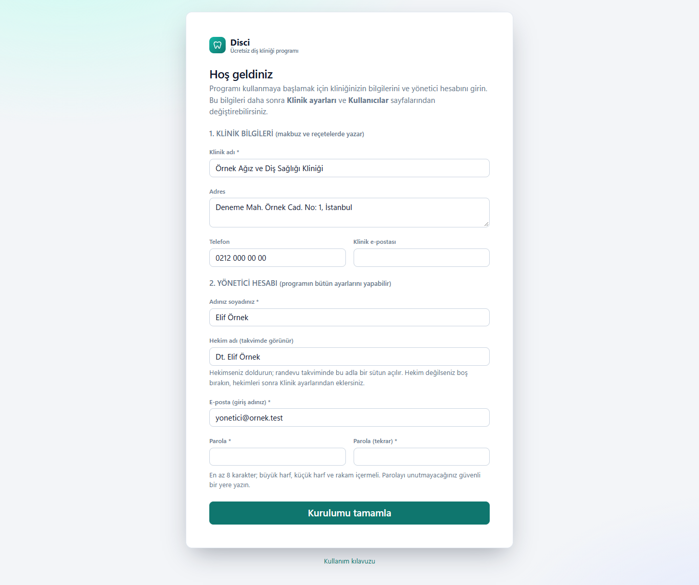

1. **Klinik bilgileri:** klinik adı, adresi, telefonu ve e-postası. Bunlar makbuz ve reçetelerin başında yazar.
2. **Yönetici hesabı:** adınız soyadınız ve giriş adınız olacak e-posta adresiniz.
3. **Hekim adı:** hekimseniz doldurun (ör. *Dt. Ayşe Yılmaz*). Randevu takviminde bu adla bir sütun açılır.
4. **Parola:** en az 8 karakter; büyük harf, küçük harf ve rakam içermeli.
5. **Kurulumu tamamla**'ya basın, ardından aynı e-posta ve parolayla giriş yapın.

> Güvenlik için bu form **yalnızca programın kurulu olduğu bilgisayarda** açılır. Ağdaki başka bir bilgisayardan
> açmaya çalışırsanız uyarı görürsünüz. Form bir kez doldurulduktan sonra bir daha açılmaz.

Kurulumdan sonra sırasıyla şunları yapmanızı öneririz:

1. **Klinik ayarları → Hekimler:** diğer hekimleri, çalışma saatlerini ve takvim renklerini ekleyin.
2. **Klinik ayarları → Randevu türleri:** muayene, dolgu, kanal tedavisi gibi işlemleri süreleriyle ekleyin.
3. **Fiyat listeleri:** fiyatları girin veya güncelleyin.
4. **Kullanıcılar:** asistanlar ve hekimler için hesap açın.

## 2. Programı açma

**Programın kurulu olduğu bilgisayarda:** masaüstündeki **Disci** kısayoluna çift tıklayın. Program arka planda
Windows hizmeti olarak sürekli çalıştığı için ayrıca başlatmanız gerekmez; bilgisayar açıldığında kendiliğinden başlar.

**Klinik ağındaki diğer bilgisayarlarda:** kurulumu yapan kişinin verdiği **Disci-Baglanti** klasöründeki
`Baglanti-Kur.bat` dosyasını bir kez çalıştırın. Masaüstüne **Disci** kısayolu gelir ve tarayıcı güvenlik uyarısı vermez.
Elle girmek isterseniz tarayıcıya sunucu bilgisayarın adını veya IP adresini yazın:

```
https://SUNUCU-ADI:5443
```

**Tablet ve telefonda:** aynı Wi-Fi ağına bağlıyken tarayıcıya yukarıdaki adresi yazın ve ana ekrana ekleyin.
İlk açılışta "bağlantı gizli değil" uyarısı çıkarsa bunun nedeni sertifikanın kliniğe özel olmasıdır; kurulum rehberindeki
"Diğer cihazlar" bölümünde sertifikanın nasıl kurulacağı anlatılır.

## 3. Giriş yapma

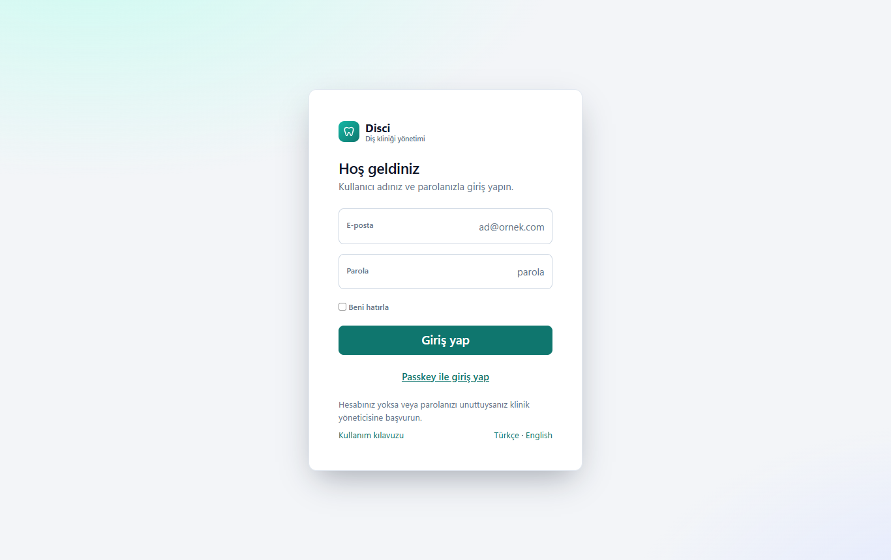

1. **E-posta** kutusuna giriş adınızı yazın.
2. **Parola** kutusuna parolanızı yazın.
3. Kendi bilgisayarınızdaysanız **Beni hatırla**'yı işaretleyebilirsiniz; ortak bilgisayarlarda işaretlemeyin.
4. **Giriş yap**'a basın.

- Hesapları yalnızca **yönetici** açar; kendi kendinize hesap açamazsınız.
- Parolayı **5 kez yanlış** girerseniz hesap bir süre kilitlenir. Biraz bekleyin veya yöneticiye başvurun.
- Parolanızı unuttuysanız yönetici size yeni parola verir (bkz. [Kullanıcılar](#14-kullanıcılar-yalnızca-yönetici)).
- İşiniz bitince, özellikle ortak bilgisayarlarda, menüden **Çıkış** yapın.

**Passkey ile giriş:** parmak izi, yüz tanıma veya Windows PIN'i ile parolasız giriş için önce **Hesabım** sayfasından
passkey ekleyin; sonra giriş ekranında **Passkey ile giriş yap**'a basın.

## 4. Ekran düzeni

- **Sol menü:** Bugün, Randevular, Hastalar, Reçeteler, Bildirimler ve görevler. Yönetici ve hekimlerde ayrıca
  *Kasa ve tahsilat* ile *Fiyat listeleri*; yöneticide *Klinik ayarları* ve *Kullanıcılar*. En altta *Kullanım kılavuzu*,
  *Hesabım* ve *Çıkış*.
- **Üst çubuk:** her sayfadan hasta arama kutusu, **Randevu** düğmesi, **zil** (ilgilenilmesi gereken işlerin sayısı) ve hesabınız.
- **Telefon ve tablette** menü gizlenir; sol üstteki **☰** düğmesiyle açılır.
- **Ekranlar kendiliğinden güncellenir:** resepsiyonda bir hasta "Geldi" yapılınca hekimin ekranında da hemen görünür.

Ekranın altında "Beklenmeyen bir hata oluştu" yazan bir şerit çıkarsa **Yenile**'ye basın. Sorun sürerse
[Sorun giderme](#18-sorun-giderme) bölümüne bakın.

## 5. Bugün (ana sayfa)

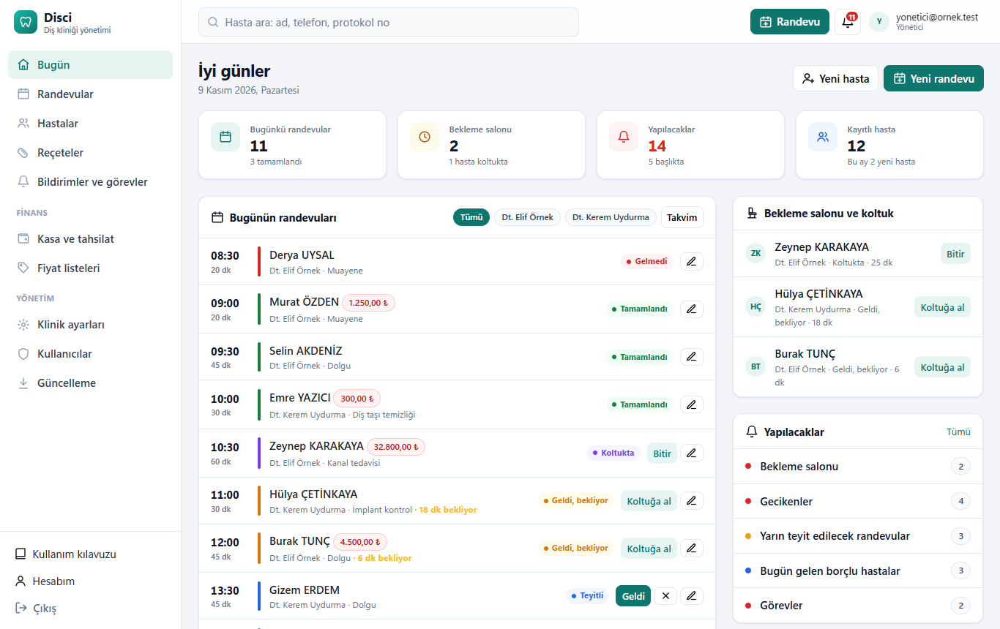

Giriş yapınca ilk bu ekran açılır; resepsiyonun günlük çalışma ekranıdır.

- **Özet kartları:** bugünkü randevu sayısı, bekleme salonundaki hasta, yapılacak iş sayısı ve kayıtlı hasta sayısı.
  Bugünkü tahsilat ve toplam alacak bu ekranda değil, **Kasa ve tahsilat** sayfasının başındadır.
- **Bugünün randevuları:** saat sırasıyla. Satırdaki düğme hastayı bir sonraki adıma taşır:
  **Teyit et → Geldi → Koltuğa al → Bitir**. Gelmeyen hasta için **✕ (Gelmedi)**.
  Borcu olan hastanın adının yanında kırmızı tutar etiketi çıkar; hasta gelince tahsilatı hatırlatmak içindir.
- **Bekleme salonu ve koltuk:** gelen hastalar ve kaç dakikadır beklediği.
- **Yapılacaklar:** bildirimlerin özeti (bkz. [Bildirimler](#10-bildirimler-ve-görevler)).

## 6. Hastalar ve arama

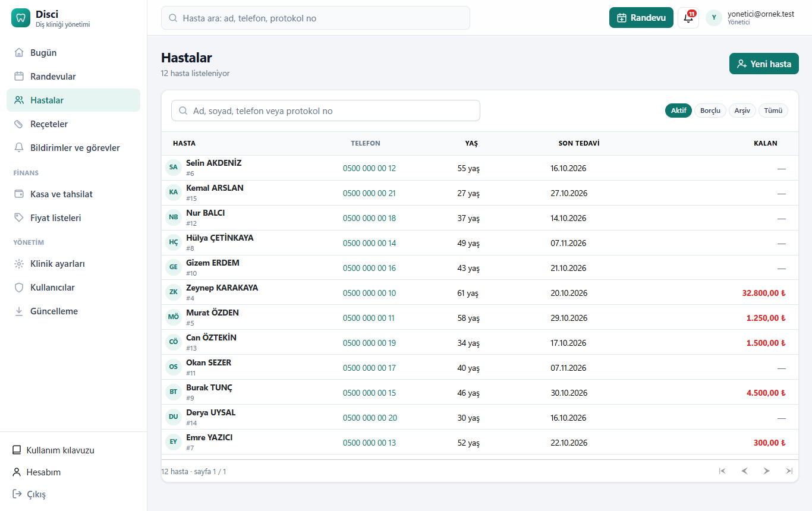

Menüden **Hastalar**'a girin veya üst çubuktaki arama kutusunu kullanın.

- Yazmaya başladığınız anda liste süzülür.
- **Ad veya soyad:** Türkçe harfle de harfsiz de yazabilirsiniz; *yılmaz*, *YILMAZ* ve *yilmaz* aynı sonucu verir.
  İki kelime yazarsanız (*ayşe yılmaz*) ikisini de içeren hastalar çıkar.
- **Telefon:** başında 0 olan ya da 7 haneden uzun sayılar telefon sayılır (*0532 111*). Boşluklu yazılmış numaralar da bulunur.
- **Protokol numarası:** 0 ile başlamayan en fazla 6 haneli sayı (*1234*). Önceden kullandığınız programdan gelen
  hastaların eski numaraları korunur ve aranabilir; ikinci bir eski kart numarası varsa o da görünür ("#123 · 2. kart #45").
- Sütun başlıklarına tıklayarak sıralayabilirsiniz. Süzgeçler: **Aktif**, **Borçlu** (en çok borcu olan üstte), **Arşiv**, **Tümü**.

**Yeni hasta:** **Yeni hasta** düğmesi. Yalnızca ad ve soyad zorunludur. Aynı TC kimlik numarası, aynı ad-soyad veya
aynı cep telefonuyla kayıtlı biri varsa program uyarır; aynı kişiyse yeni kayıt açmayın. Formda iletişim bilgileri,
adres, yakınlar, sağlık bilgileri (anamnez), tarife ve sabit indirim girilir.

## 7. Hasta kartı

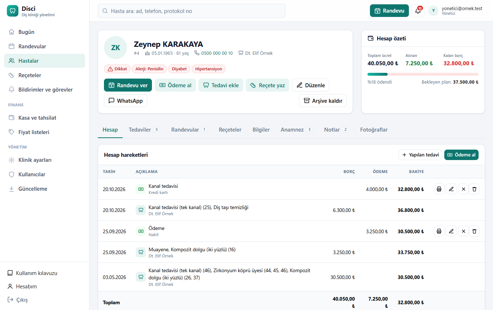

Kartın üstünde hastanın adı, protokol numarası, yaşı, telefonu, hekimi ve sonraki randevusu görünür.
Telefondan bakıyorsanız numaraya dokunarak arayabilirsiniz.

- **Kırmızı etiketler** (Alerji, Diyabet, Kalp hastalığı…) hastanın sağlık uyarılarıdır. Tedaviden önce mutlaka bakın.
- **Düğmeler:** Randevu ver, Ödeme al, Tedavi ekle, Reçete yaz, Düzenle, WhatsApp, Arşive kaldır.
- **Arşive kaldır:** hasta aktif listeden ve randevu aramasından kalkar; kayıtları silinmez. Geri almak için
  Hastalar → **Arşiv** süzgecinde bulup **Arşivden çıkar**'a basın.

### Hesap özeti

| Alan | Anlamı |
|---|---|
| Toplam ücret | "Yapıldı" durumundaki tedavilerin toplamı |
| Alınan | İptal edilmemiş ödemelerin toplamı |
| Kalan borç | Toplam ücret eksi alınan. Eksi çıkarsa "Fazla ödeme" yazar |
| Bekleyen plan | Planlanmış ama yapılmamış tedavilerin tutarı (borca eklenmez) |

> Bakiye Türk lirası kayıtlarla hesaplanır. Döviz ile girilmiş kayıtlar listede görünür ama bakiyeye katılmaz.

### Sekmeler

- **Hesap:** borç (yapılan tedavi) ve ödeme hareketleri tarih sırasıyla; her satırda o günkü bakiye. Ödeme satırındaki
  yazıcı düğmesi makbuzu açar.
- **Tedaviler:** ağız şeklindeki diş şeması ve altında tedavi planı ile yapılan tedaviler (bkz. [bölüm 8](#8-tedavi-ödeme-ve-makbuz)).
- **Randevular:** hastanın geçmiş ve gelecek randevuları.
- **Reçeteler:** yazılan reçeteler; yazdır, aynısını yeniden yaz, düzenle.
- **Bilgiler:** kimlik, iletişim, adres, kayıt tarihi, tarife, hekimi, referansı ve yakınları.
  *Hekimi* "Ortak havuz" ise hasta belirli bir hekime atanmamıştır.
- **Anamnez:** tıbbi geçmiş; "evet" işaretlenmiş durumlar etiket olarak görünür. Alerji ayrıntıları ve notlar alttadır.
- **Notlar:** hastaya ait genel notlar ve dişe özel notlar; üstteki kutudan yeni not eklenir.
- **Fotoğraflar:** ağız içi ve yüz fotoğrafları; büyütmek için fotoğrafa tıklayın.

## 8. Tedavi, ödeme ve makbuz

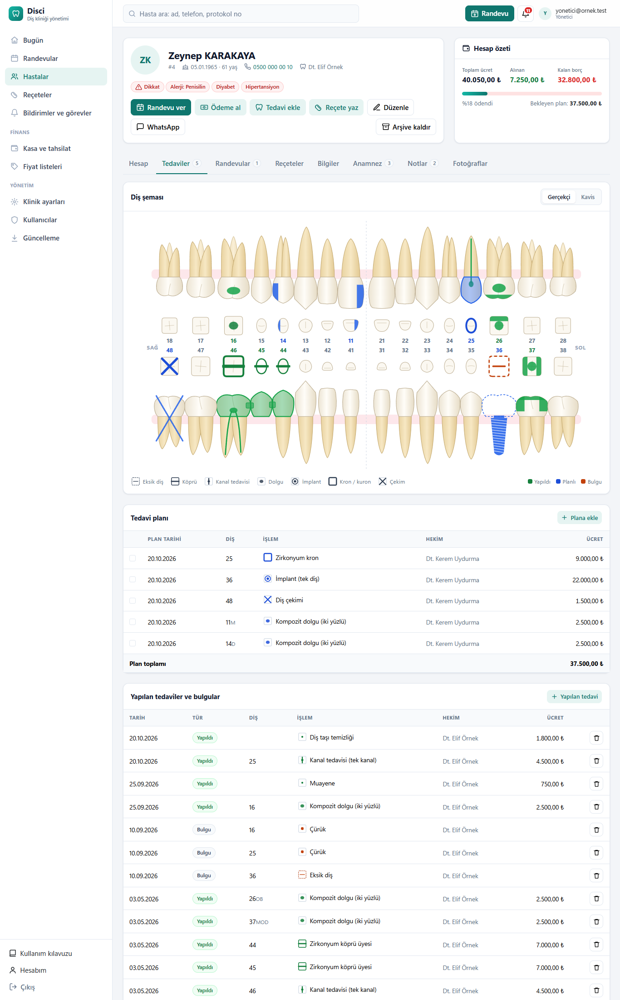

### Diş şeması

Şemanın sağ üstündeki düğmeyle iki görünüm arasında geçilir; hastanın sağı her ikisinde de ekranın solundadır.
Renkler: **yeşil** yapıldı, **mavi** planlı, **turuncu** bulgu. Dişin üstüne gelince o dişin bütün kayıtları çıkar.

**Gerçekçi görünüm (varsayılan):** Her diş yandan, kronu ve kökleriyle çizilir: üst çenede kökler yukarı, alt çenede
aşağı bakar; dişlerin arasında her dişin üstten (çiğneme yüzeyinden) görünümü vardır. Tedaviler diş hekimliğindeki
alışılmış biçimleriyle görünür:

| Tedavi | Gerçekçi görünümde |
|---|---|
| Dolgu | Kron üzerinde renkli alan; yüzeyi girildiyse o yüzey boyanır (üstten görünümde de) |
| Kanal tedavisi | Köklerin içinde renkli kanal çizgileri |
| Kron, köprü | Kron renkli; köprüde dişler arasında bağlantı, eksik dişin yerinde köksüz gövde |
| İmplant | Kökün yerinde vida; kron henüz yoksa yeri kesik çizgiyle |
| Çekim (planlı) | Dişin üstünde çarpı; çekildiğinde ve eksik dişte diş soluk, kesik çizgili |
| Post / pivot | Kökün içinde çubuk |
| Apse / lezyon | Kök ucunda halka |
| Gömülü diş | Diş kemiğin içinde, eğik |
| Ortodonti | Braket ve dişler arasında tel |

Süt dişleri ayrı sekmededir (**Daimi dişler / Süt dişleri**); yalnızca süt dişlerinde kaydı olan bir çocukta şema
süt dişleriyle açılır.

**Kavis görünümü:** Dişler üstten, gerçek ağız kavsi şeklinde ve boyutlarına oranlı çizilir; süt dişleri iç kavistedir.
Her tedavi dişin üstünde **kendi simgesiyle** görünür; şemanın altındaki açıklama o hastada kullanılan simgeleri listeler:

| Simge | Anlamı |
|---|---|
| Dolu oval | Dolgu |
| Ortadan geçen çizgi ve nokta | Kanal tedavisi |
| Dişin çevresinde kalın halka | Kron / kuron |
| Dişten geçen çubuk | Köprü (gövde) |
| Dış yüzde kalın yay | Lamina / veneer |
| Kare ve halka | Post / pivot |
| Halka ve altıgen | İmplant |
| Çarpı (X) | Çekim |
| Kesikli çerçeve | Eksik diş |
| Üç nokta | Fissür örtücü |
| Koyu leke | Çürük (diş tedavi edilince gösterilmez) |
| Halka ve nokta | Apse / lezyon / kist |
| Zikzak çizgi | Kırık |
| Yay ve kesikli çizgi | Gömülü diş |
| Dalgalı çizgi | Protez |
| Dış yüzde kare ve tel | Ortodonti (braket) |

Simge işlemin adından tahmin edilir ("kompozit dolgu" → dolgu, "zirkonyum kron" → kron). Yanlış tahmin edilen bir işlemi
**Fiyat listeleri**'nde işlemin kalem düğmesine basıp **Diş şemasındaki simge** alanından düzeltin. Tedavi listelerinde
ve tedavi eklerken işlem adlarının yanında da küçük simgesi görünür.

Diş numaraları uluslararası (FDI) sisteme göredir:

| | Sağ üst | Sol üst | Sol alt | Sağ alt |
|---|---|---|---|---|
| Kalıcı dişler | 11–18 | 21–28 | 31–38 | 41–48 |
| Süt dişleri | 51–55 | 61–65 | 71–75 | 81–85 |

### Tedavi eklemek

Hasta kartında **Tedavi ekle**:

1. Kayıt türünü seçin: **Plan** (yapılacak), **Yapıldı** (bugün yapıldı, borca eklenir) veya **Bulgu** (ücretsiz tespit:
   kayıp diş, implant mevcut vb.).
2. Diş şemasından dişleri seçin; birden çok seçilebilir. Hiç seçmezseniz tüm ağız sayılır.
3. İşlemi adıyla arayın. Ücret hastanın fiyat listesinden gelir; hastanın sabit indirimi varsa uygulanır. Ücreti değiştirebilirsiniz.
   Dolgu, çürük ve fissür örtücüde **Yüzeyler** düğmeleri çıkar (isteğe bağlı): **M** mezial, **O** okluzal/insizal,
   **D** distal, **B** bukkal/labial, **L** lingual/palatinal. Örneğin iki yüzlü dolgu için M ve O. Seçilen yüzeyler şemada
   boyanır ve listelerde diş numarasının yanında yazar ("16 MO"). Diş seçimi de gerçekçi ya da kavis görünümüyle yapılabilir.
4. **Ekle**'ye basın; başka işlem de ekleyebilirsiniz. Sonra **Kaydet**. Ücret diş başınadır.

**Planı tamamlamak:** Tedaviler sekmesinde plandaki satırları işaretleyip **… işlemi yapıldı say**'a basın. Seçilenler
bugünün tarihiyle "Yapıldı" olur ve borca eklenir. **Plandan çıkar** plandaki kalemi siler. Ücretli bir kaydı yalnızca
yönetici ve hekim silebilir.

### Ödeme almak

**Ödeme al** düğmesi. Tutar kendiliğinden kalan borç olarak gelir; değiştirebilirsiniz. Ödeme şeklini seçin
(Nakit, Kredi kartı, Havale/EFT, Çek/Senet), gerekirse açıklama ("implant 1. taksit") ve makbuz no yazın.

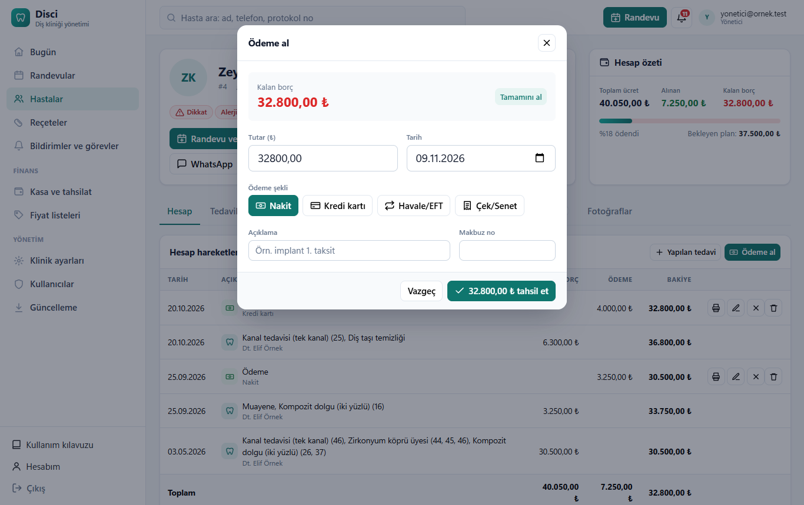

**Makbuz:** Hesap sekmesinde ödemenin yanındaki yazıcı düğmesi. Açılan sayfada **Yazdır**'a basın; tutar yazıyla da yazılır.
Makbuzun başındaki klinik bilgileri **Klinik ayarları**'ndan gelir.

**Ödemeyi düzeltmek** (yönetici, hekim ve asistan): Hesap sekmesinde ödemenin yanındaki düğmeler:

- **Kalem (düzenle):** tutar, tarih, ödeme şekli, banka, vade, açıklama ve makbuz no değiştirilir.
- **✕ (iptal):** kayıt silinmez, üstü çizili kalır ve bakiyeye katılmaz. İptal edilen ödemede **geri al** düğmesi çıkar.
- **Çöp kutusu (sil):** ödeme kalıcı olarak silinir, geri alınamaz. Yanlış girilmiş bir ödemeyi izini bırakarak
  kapatmak için silmek yerine iptal etmeyi tercih edin.

## 9. Randevular

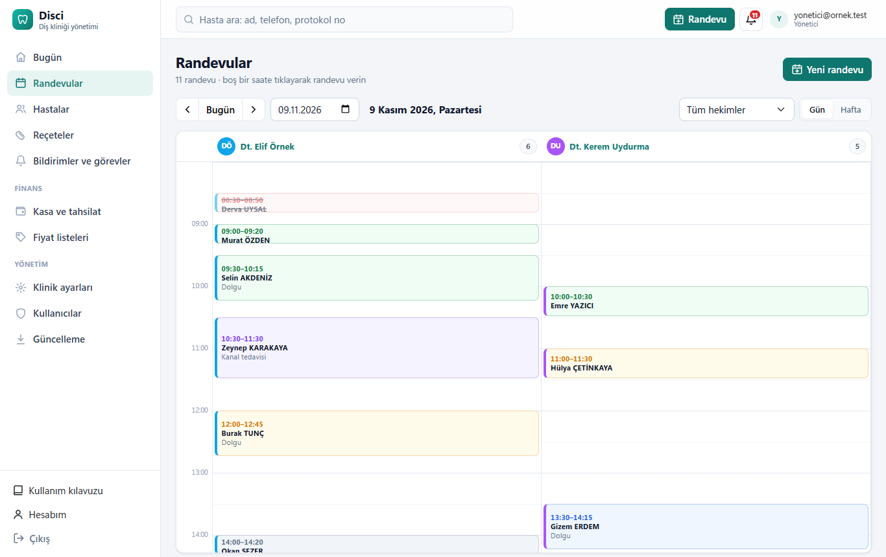

Menüden **Randevular**'a girin.

- **Gün** görünümünde her hekim bir sütundur; **Hafta** görünümünde her gün bir sütun. Hekim kutusundan tek hekime
  süzebilirsiniz. Hekim hesabıyla girilince takvim hekimin kendi sütunuyla açılır.
- **Randevu vermek:** takvimde boş bir saate tıklayın (ya da **Yeni randevu**). Hastayı adı, telefonu veya protokol
  numarasıyla arayıp seçin. Kayıtlı olmayan biri için **Kayıtsız hasta**'yı açıp ad ve telefon yazın. İşlem türü
  seçilince süre kendiliğinden gelir.
- Seçilen saatte hekimin ya da hastanın başka randevusu varsa program **"Bu saat dolu"** der ve kaydetmez.
- **Randevuyu açmak:** üstüne tıklayın. Saat, hekim, not ve **durum** değiştirilebilir. **Hatırlat** düğmesi hastaya
  hazır bir WhatsApp hatırlatma mesajı açar; mesajı siz gönderirsiniz.
- Renkler: gri randevulu, mavi teyitli, turuncu geldi/bekliyor, mor koltukta, yeşil tamamlandı, kırmızı gelmedi.
  Kırmızı yatay çizgi şu anki saattir.

## 10. Bildirimler ve görevler

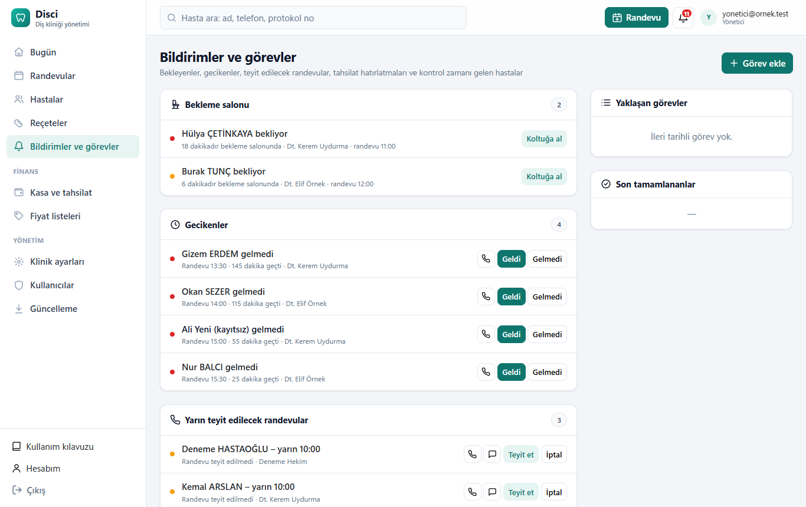

Üst çubuktaki **zil**, şu an ilgilenilmesi gereken işlerin sayısını gösterir. Tamamı **Bildirimler ve görevler** sayfasındadır.

| Bölüm | Ne yapılır |
|---|---|
| Bekleme salonu | 15 dakikadan uzun bekleyen kırmızı görünür; **Koltuğa al** |
| Gecikenler | Randevu saati 10 dakikadan fazla geçmiş ama gelmemiş: arayın, **Geldi** veya **Gelmedi** |
| Yarın teyit edilecekler | Telefonla ya da WhatsApp ile ulaşıp **Teyit et** veya **İptal** |
| Bugün gelen borçlu hastalar | Gelince tahsilatı hatırlayın |
| Görevler | Bugün veya geçmiş tarihli görevler; bitince **Tamamlandı** |
| Doğum günleri | İsterseniz kutlama mesajı gönderin |
| Kontrol zamanı gelenler | Son tedavisinden 6 ay geçmiş, randevusu olmayan hastalar; **Randevu ver** |

**Görev eklemek:** **Görev ekle** → görevi yazın ("laboratuvardan kron gelince hastayı ara"), tarihini, kimin için
olduğunu (Herkes / Asistan / Hekim) ve isterseniz hastayı seçin.

## 11. Reçete

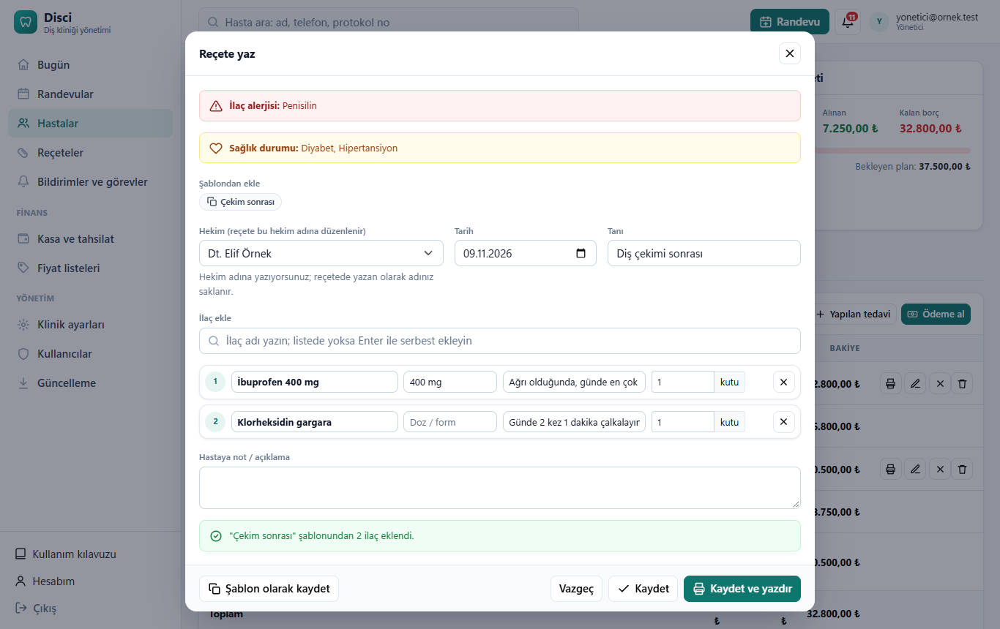

Hasta kartında **Reçete yaz**:

1. Pencerenin üstünde hastanın **ilaç alerjisi** (kırmızı) ve sağlık durumları görünür; önce bunlara bakın.
2. **Hekim:** reçete her zaman bir hekim adına düzenlenir. Asistanlar hekim adına yazabilir; yazan kişi ayrıca saklanır.
3. **Tanı** yazın. Hazır şablon varsa **Şablondan ekle** altındaki düğmeye basın (ör. *Çekim sonrası*); ilaçlar ve tanı
   tek tıkla gelir. Hastanın alerjisiyle eşleşen ilaç içeren şablonlar **kırmızı** ve ⚠ işaretli görünür.
4. **İlaç ekle** kutusuna ilacın adını yazın ve listeden seçin; doz ve kullanım kendiliğinden gelir. Listede olmayan ilaç
   için **Enter**'a basın; "Bu ilacı ilaç listesine de ekle" işaretlenirse sonraki sefer listede çıkar.
5. Her ilaç için kutu sayısını girin, gerekirse not yazın.
6. **Kaydet ve yazdır**: reçete A5 kâğıda göre hazırlanır ve yazdırma penceresi açılır.

> İlaç adı hastanın alerjisiyle eşleşirse (ör. penisilin alerjisi olan hastaya amoksisilin) satır kırmızı çerçevelenir
> ve **"Hastanın alerjisiyle eşleşiyor"** uyarısı çıkar. Program reçeteyi engellemez; uyarı yardımcıdır, bütün ilaç
> etkileşimlerini bilmez. Son karar hekimindir.

**Reçeteler sayfası** (menü): *Yazılan reçeteler* (tarih, hekim, hasta/ilaç adıyla süzme), *Şablonlar* ve *İlaç listesi*
sekmeleri. Şablonları yönetici ve hekimler düzenler, asistanlar kullanır. Şablon listesi boşken **Örnek şablonları ekle**
birkaç örnek ekler; kullanmadan önce hekim olarak kontrol edip kliniğinize göre düzenleyin.

> E-Reçete (Medula) bağlantısı yoktur; bu ekran kâğıt reçete içindir.

## 12. Kasa ve fiyat listeleri (yönetici, hekim)

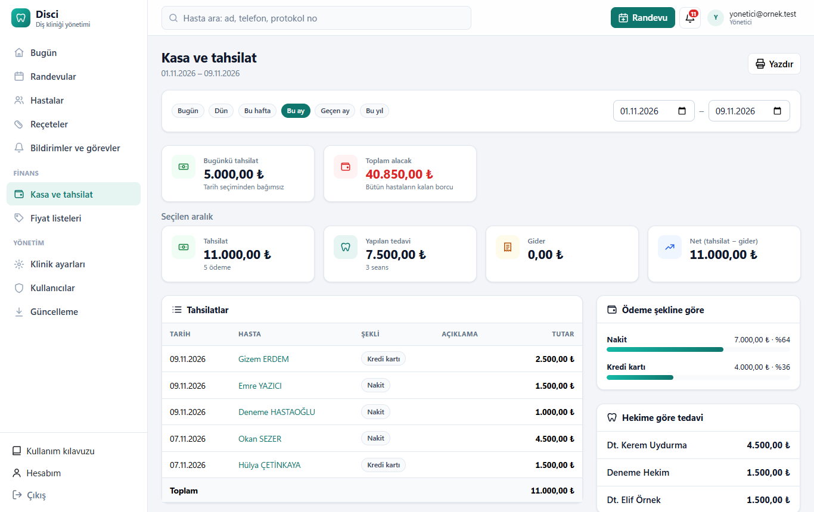

**Kasa ve tahsilat:** Bugün, Dün, Bu hafta, Bu ay, Geçen ay, Bu yıl ya da istediğiniz tarih aralığı için tahsilat, yapılan
tedavi, gider ve net tutar; ödeme şekline ve hekime göre dağılım, günlük döküm ve en yüksek alacaklar. **Yazdır** ile çıktı alınır.

**Fiyat listeleri:**

- Soldan listeyi seçin. Fiyatı hücreye yazıp hücreden çıkınca kaydedilir (KDV dahil fiyat). Hücreyi boşaltmak fiyatı kaldırır.
- **Toplu güncelle:** yüzde yazın (ör. `15`; indirim için `-10`). Arama veya kategori süzgeci açıksa yalnızca listelenenler
  değişir. Fiyatlar tam liraya yuvarlanır.
- **Listeyi kopyala:** kuruma veya kampanyaya özel yeni tarife açar. **Varsayılan yap:** tarifesi seçilmemiş hastalarda kullanılır.
- **Yeni işlem:** listede olmayan bir tedaviyi kod, ad ve kategoriyle ekler. İşlem adını düzenleyebilir veya listeden
  kaldırabilirsiniz (kaldırılanlar "Kaldırılanları göster" ile geri alınır).
- Hastaya özel tarife ve sabit indirim hasta kartında **Düzenle**'den seçilir.

## 13. Klinik ayarları (yalnızca yönetici)

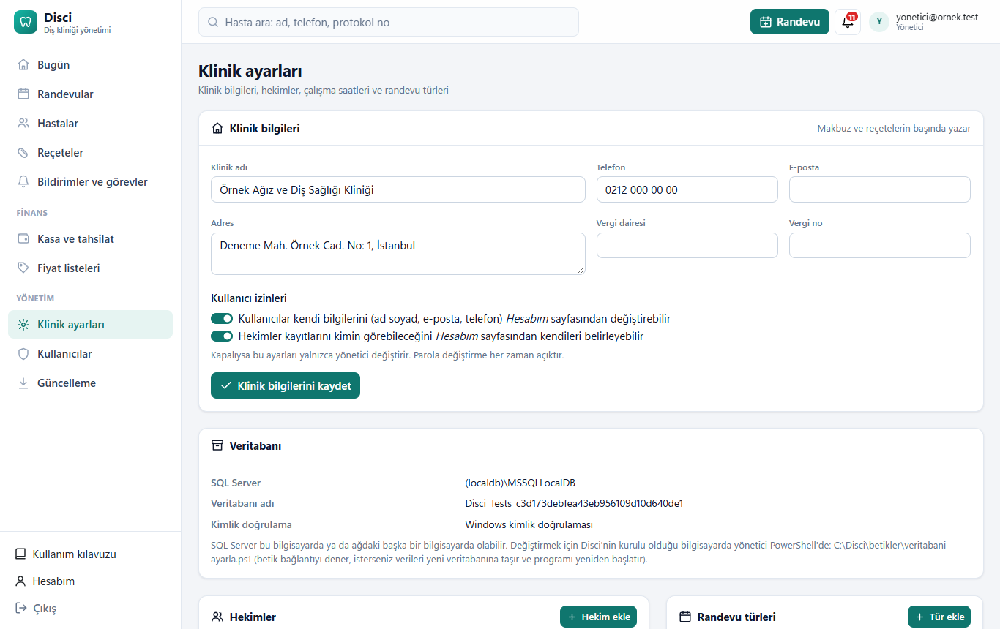

- **Klinik bilgileri:** klinik adı, adres, telefon, e-posta, vergi dairesi ve numarası. Makbuz ve reçetelerin başında yazar.
  Değiştirip **Klinik bilgilerini kaydet**'e basın.
- **Kullanıcı izinleri:** "Kullanıcılar kendi bilgilerini değiştirebilir" (ad soyad, e-posta, telefon; Hesabım → Profil)
  ve "Hekimler kayıtlarını kimin görebileceğini kendileri belirleyebilir". Kapatılırsa bunları yalnızca yönetici değiştirir.
- **Hekimler:** ad, uzmanlık, takvim rengi, mesai başlangıç ve bitişi (takvimin saatleri buna göre ayarlanır), etkin/pasif.
  Pasif hekim takvimde görünmez, eski kayıtlarda adı kalır. **Kullanıcı** sütunu hekimin giriş hesabını gösterir;
  "Hesap yok" yazıyorsa **Kullanıcılar** sayfasından hekime bir hesap açın (her hekimin kendi kullanıcısı olmalı).
- **Paylaşım ve izinler** (hekim satırındaki kişiler düğmesi): o hekimin kayıtlarını kim görür, kim işlem yapar.
  - **Diğer hekimler** ve **Asistanlar** için ayrı ayrı: *Görür ve işlem yapar* (varsayılan), *Yalnızca görür*, *Göremez*.
  - Kapsadığı kayıtlar: hekimin **kendi hastaları** (hasta kartındaki "Hekim" alanı o hekim olanlar), o hekimin
    randevuları, tedavileri ve reçeteleri. Hekimi boş hastalar herkese açıktır.
  - *Göremez*: hekimin adı başkalarının takviminde, hekim seçiminde ve raporlarında çıkmaz; hastalarının kartı açılmaz.
    Başka hekimin hastasında o hekimin tedavileri hesapta yalnızca "Başka bir hekimin tedavisi" olarak (tutarıyla) görünür.
  - *Yalnızca görür*: kayıtlar görünür ama o hekim adına randevu, tedavi, reçete girilemez ve değiştirilemez.
  - **Kişiye özel izinler:** belirli bir kullanıcıya farklı izin (ör. hekim *Göremez* dese de kendi asistanı görsün).
  - Yöneticiler ve hekimin kendi hesabı her zaman her şeyi görür.
- **Randevu türleri:** ad, süre ve renk (Muayene 20 dk, Dolgu 45 dk, Kanal tedavisi 60 dk gibi).
- **Veritabanı:** programın kullandığı SQL Server, veritabanı adı ve kimlik doğrulama türü (parola gösterilmez).
  SQL Server bu bilgisayarda ya da ağdaki başka bir bilgisayarda olabilir. Bağlantıyı değiştirmek için Disci'nin kurulu
  olduğu bilgisayarda yönetici PowerShell'de `C:\Disci\betikler\veritabani-ayarla.ps1` (Linux/macOS'ta kurulum
  klasöründe `./veritabani-ayarla.sh`); ayrıntı kurulum rehberinde.

## 14. Kullanıcılar (yalnızca yönetici)

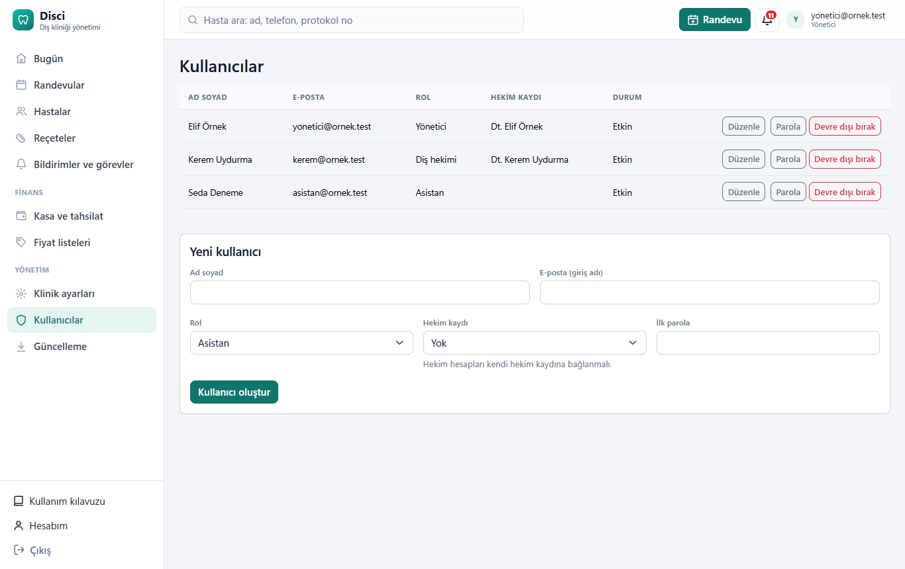

### Roller

| Rol | Kimler için | Neler yapabilir |
|---|---|---|
| Yönetici | Klinik sahibi, sorumlu kişi | Her şey: ayarlar, kullanıcılar, kasa, fiyatlar, ödeme iptali |
| Hekim | Diş hekimleri | Hasta, tedavi, ödeme, reçete, kasa ve fiyat listeleri, ödeme iptali |
| Asistan | Asistan ve sekreterler | Randevu, hasta kaydı, tedavi ve ödeme girişi, hekim adına reçete |

### Yeni kullanıcı açma

1. **Ad soyad** ve **E-posta** yazın; e-posta kişinin giriş adı olur.
2. **Rol** seçin.
3. **Hekim kaydı:** hekim hesabı açıyorsanız listeden hekimi seçin veya **Yeni hekim kaydı oluştur**'u seçin.
   Asistan ve yöneticiler için genellikle **Yok**.
4. **İlk parola** yazın (en az 8 karakter, büyük/küçük harf ve rakam) ve **Kullanıcı oluştur**'a basın.
5. Giriş adını ve parolayı kişiye **yüz yüze** iletin; ilk girişte parolasını değiştirmesini söyleyin.

**Bilgileri düzenleme:** kullanıcının satırında **Düzenle**: ad soyad, e-posta (giriş adı), telefon, rol ve hekim kaydı.
Hekim hesabı kendi hekim kaydına bağlanınca randevu, tedavi ve reçetede hekim olarak kendisi seçili gelir.

**Parola sıfırlama:** kullanıcının satırında **Parola** → yeni parola → **Kaydet**.

**Hesabı kapatma:** işten ayrılan birinin hesabını silmek yerine **Devre dışı bırak**'a basın. Kişi hemen sistemden
çıkarılır ve bir daha giremez; geçmiş kayıtları korunur. **Etkinleştir** ile geri açılır. Kendi hesabınızı kapatamazsınız.

## 15. Hesabım ve parola değiştirme

Menünün altındaki **Hesabım**:

- **Profil:** ad soyad, e-posta (giriş adınız) ve telefon. Klinik ayarlarında izin kapalıysa bunları yalnızca yönetici
  değiştirir. **Ekran dili** buradan seçilir: *Türkçe* ya da *English*. Seçim hesabınızda saklanır; başka bilgisayardan
  girdiğinizde de geçerli olur. Giriş sayfasının altındaki **Türkçe · English** bağlantıları da dili değiştirir.
  İngilizcede programın yazıları değişir; kliniğin girdiği bilgiler (işlem adları, notlar) ve tarih/tutar biçimi aynı kalır.
- **Parola:** mevcut parolanızı ve iki kez yeni parolanızı yazıp kaydedin.
- **Kayıtlarımı kimler görür** (yalnızca hekim hesapları): kendi hastalarınızı, randevularınızı ve tedavilerinizi diğer
  hekimlerin ve asistanların görüp göremeyeceği, işlem yapıp yapamayacağı ve kişiye özel izinler (bkz. bölüm 13).
- **Geçiş anahtarları (passkey):** bilgisayarınızın veya telefonunuzun parmak izi, yüz tanıma ya da PIN doğrulamasıyla parolasız giriş.
- **İki adımlı doğrulama:** telefondaki bir doğrulama uygulamasıyla (Google veya Microsoft Authenticator) ek güvenlik.

**İlk girişte** yöneticinin verdiği parolayı mutlaka değiştirin.

## 16. Güncelleme (yalnızca yönetici)

Menüde **Yönetim → Güncelleme**. Program yeni bir sürüm çıkınca menüde **yeni** etiketiyle haber verir.

- **Şimdi denetle:** GitHub'daki en yeni sürümü sorar; sürüm notları ("yenilikler") sayfada görünür.
- **Şimdi güncelle:** en geç 10 dakika içinde güncelleme görevi yeni sürümü indirir, doğrular, **önce yedek alır** ve
  kurar. Bu sırada program birkaç dakika açılmaz; diğer bilgisayarlardaki kullanıcılara haber verin. Yeni sürüm açılmazsa
  eski sürüme kendiliğinden dönülür. Sonuç "Güncelleme görevi" kutusunda görünür.
- **Yeni sürüm çıkınca kendiliğinden kur:** açıksa güncellemeler gece 03:00-05:00 arasında yapılır (bilgisayar açıksa).

Güncelleme görevi 1.1.0 ve sonraki kurulumlarla gelir; 1.0.x'ten geçiş için kurulum rehberindeki *Yeni sürüme geçiş*
bölümüne bakın.

## 17. Yedekleme ve geri yükleme

Kurulum, **her gün saat 14:00'te** otomatik yedek alacak şekilde ayarlanır (bilgisayarın açık olduğu bir saat seçildi):

- Veritabanı ve hasta fotoğrafları `C:\DisciVeri\Yedekler` klasörüne yedeklenir; **son 14 gün** saklanır.
- Bilgisayar o saatte kapalıysa yedek, açıldığında alınır.
- Elle yedek almak için yönetici PowerShell'de: `C:\Disci\betikler\yedekle.ps1`

> **Yedekleri başka bir yere de kopyalayın.** Bilgisayar bozulur veya çalınırsa aynı bilgisayardaki yedekler de
> gider. Haftada bir `C:\DisciVeri\Yedekler` klasörünü harici bir diske veya USB belleğe kopyalayın ya da bu klasörü
> OneDrive / Google Drive ile eşitleyin.

**Geri yükleme:** bir yedeğe dönmek gerekirse [Kurulum rehberi](https://github.com/mehmet-cizmeci/Disci/blob/main/docs/Kurulum-Rehberi.md)'ndeki "Yedekten geri yükleme"
adımlarını izleyin. Geri yükleme, yedekten sonra girilen kayıtları siler; emin değilseniz önce yeni bir yedek alın.

## 18. Sorun giderme

**"Bu siteye ulaşılamıyor" diyor.**
Sunucu bilgisayar kapalı veya uykuda olabilir. Açın ve bir dakika bekleyin. Hâlâ açılmıyorsa sunucu bilgisayarda
*Hizmetler* (Windows tuşu → "Hizmetler") içinde **Disci Klinik Programı**'nın "Çalışıyor" olduğuna bakın; değilse sağ
tıklayıp **Başlat**'a basın.

**Diğer bilgisayardan açılıyor ama sunucuda açılmıyor (ya da tersi).**
Sunucunun ağ bağlantısının **Özel ağ** olduğundan emin olun (Ayarlar → Ağ ve İnternet → bağlantı → Ağ profili türü: Özel).
Ortak ağda Windows güvenlik duvarı diğer cihazları engeller.

**Sunucunun IP adresi değişti, kısayol açılmıyor.**
Modem her açılışta farklı adres verebilir. Kısayolu bilgisayar adıyla kullanın veya modemden sunucuya sabit IP verin
(bkz. kurulum rehberi).

**"E-posta veya parola yanlış" diyor.**
Büyük/küçük harfe ve klavye dilinin doğru olduğuna dikkat edin. 5 yanlış denemeden sonra hesap kilitlenir.

**Bir hastayı bulamıyorum.**
Soyadın bir kısmını veya telefonun son 4 rakamını yazın; listede **Arşiv** ve **Tümü** süzgeçlerini de deneyin.

**Ekranda "Beklenmeyen bir hata oluştu" şeridi çıkıyor, düğmeler çalışmıyor.**
Sayfayı yenileyin (F5). Yalnızca bir tarayıcıda oluyorsa o tarayıcının eklentilerinden biri (özellikle WebSocket veya
reklam engelleyici eklentiler) programla çakışıyor olabilir; başka bir tarayıcıyla deneyin.

**Yanlış girilen ödemeyi nasıl silerim?**
Ödemeler silinmez; yönetici veya hekim Hesap sekmesinden **iptal eder**. İptal edilen ödeme üstü çizili kalır ve bakiyeye katılmaz.

**Yönetici parolasını unuttum ve başka yönetici yok.**
Kurulum rehberindeki "Yönetici parolasını sıfırlama" bölümüne bakın.

---

Disci ücretsiz ve açık kaynak kodludur (MIT lisansı). Kaynak kod, güncellemeler ve sorun bildirimi:
<https://github.com/mehmet-cizmeci/Disci>
